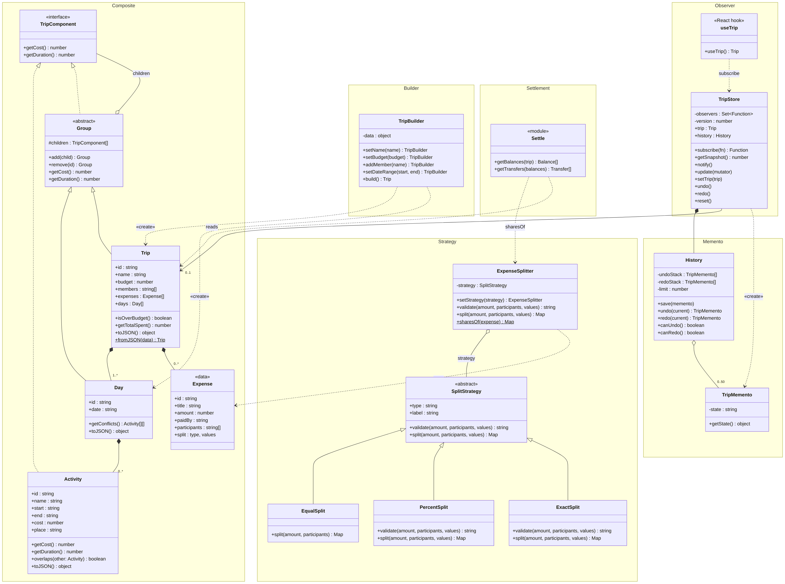
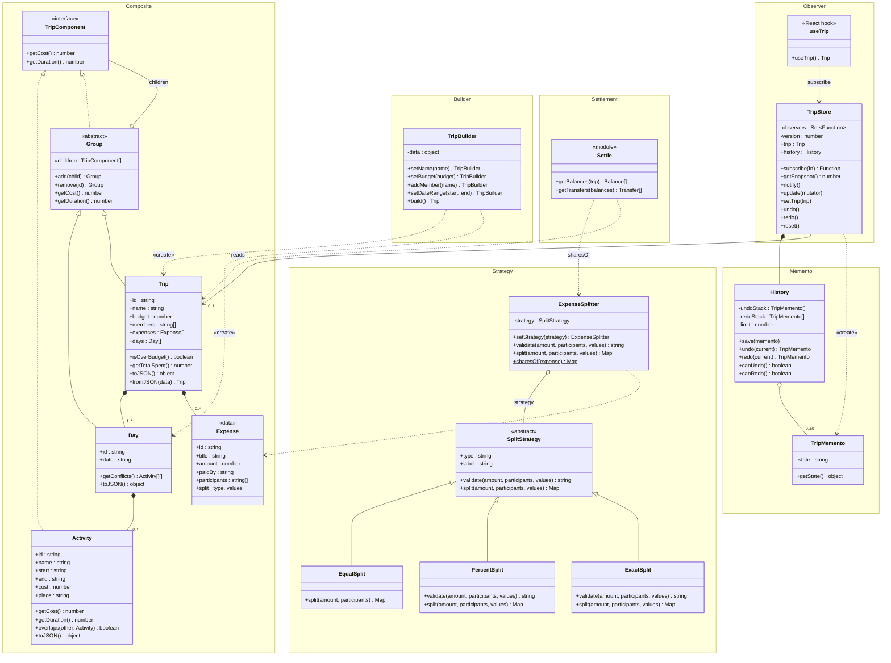
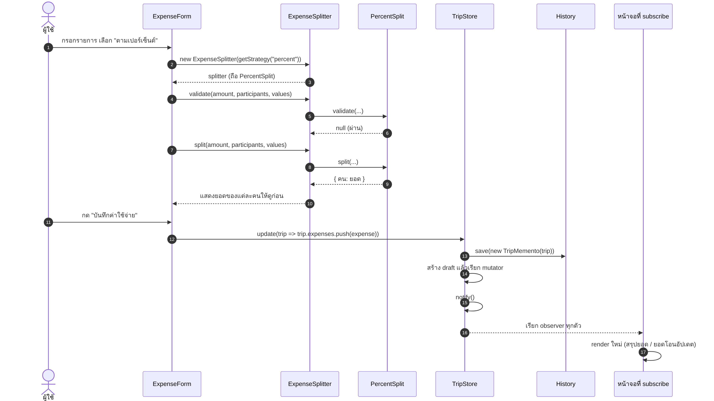
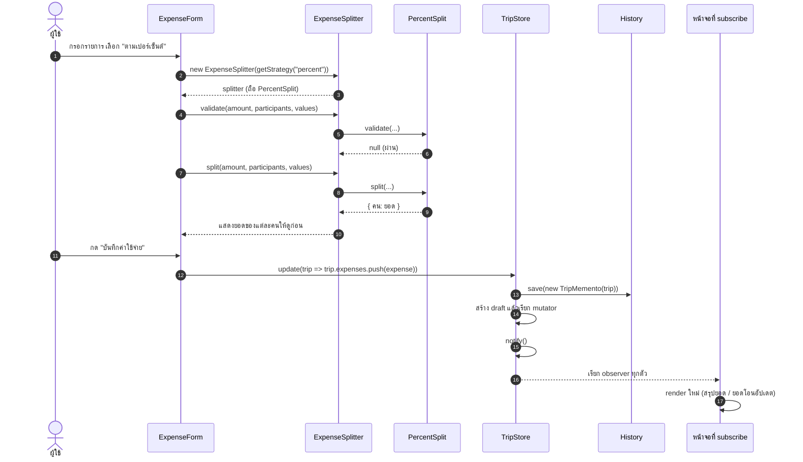
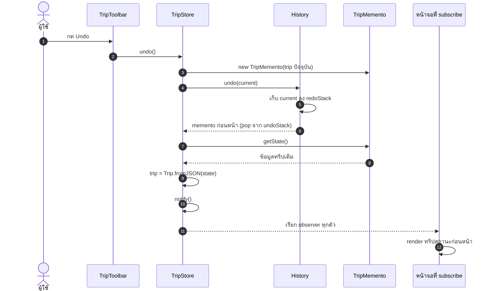
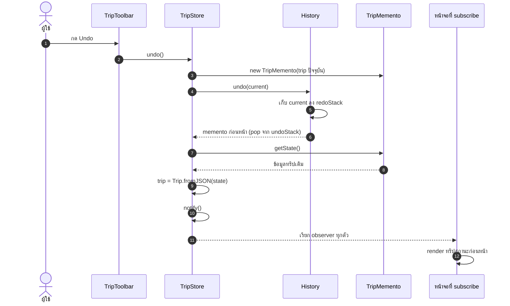

# UML: SharedTrip Planner

แผนภาพทั้งหมดในโฟลเดอร์นี้ทำตามโค้ดจริงใน `src/`
- ไฟล์ `.mmd` คือต้นฉบับ (Mermaid) แก้แล้ว GitHub จะวาดใหม่ให้เอง
- ไฟล์ `.png` / `.svg` ใช้ใส่สไลด์นำเสนอ

## 1. Class Diagram

| Pattern | คลาส | บทบาท |
|---|---|---|
| Composite | `TripComponent`, `Group`, `Trip`, `Day`, `Activity` | `Trip` → `Day` → `Activity` ทุกชั้นมี `getCost()` / `getDuration()` เรียกจาก `Trip` ทีเดียวได้ยอดรวมทั้งทริป |
| Builder | `TripBuilder` | สร้าง `Trip` ทีละขั้น (`setName` → `setBudget` → `setDateRange` → `addMember`) แล้วตรวจข้อมูลใน `build()` |
| Memento | `TripMemento`, `History` | เก็บสำเนาทริปเป็น JSON ก่อนทุกการแก้ไข ใช้ทำ Undo / Redo (เก็บสูงสุด 50 ครั้ง) |
| Observer | `TripStore`, `useTrip` | `TripStore` เป็น Subject เมื่อข้อมูลเปลี่ยนจะ `notify()` ทุกหน้าจอที่ `subscribe` อยู่ |
| Strategy | `SplitStrategy`, `EqualSplit`, `PercentSplit`, `ExactSplit`, `ExpenseSplitter` | วิธีหารเงินสลับได้ตอนรัน `ExpenseSplitter` (Context) เรียก `split()` โดยไม่ต้องรู้ว่าเป็นแบบไหน |

หมายเหตุ: JavaScript ไม่มี `interface` จริง `TripComponent` จึงเป็น interface เชิงแนวคิด ทั้ง `Activity` และ `Group` มีเมธอดชุดเดียวกัน (duck typing)

## 2. Sequence Diagram: เพิ่มค่าใช้จ่ายแบบหารตามเปอร์เซ็นต์

แสดง Strategy + Memento + Observer ทำงานร่วมกัน

## 3. Sequence Diagram: กด Undo

